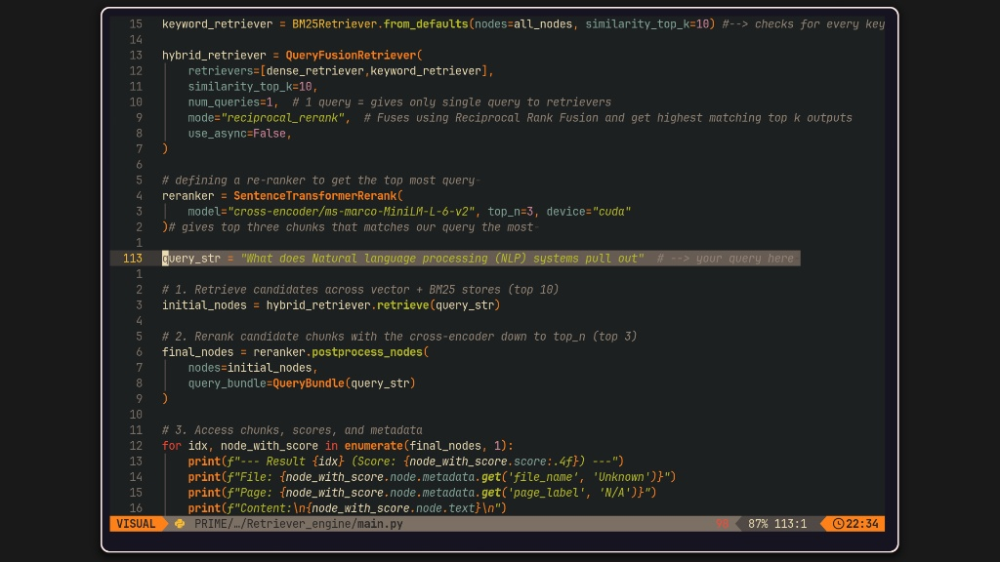

<!-- Header Banner -->
<div align="center">
  <h1>🤖 PRIME-Retriever: Hybrid RAG Engine</h1>
  <p><i>Next-generation document intelligence powered by Hybrid Search and Cross-Encoder Reranking.</i></p>
  
  <!-- Replace 'main.py.png' with the actual filename of your uploaded screenshot -->
  
</div>

<br />

## 📖 Overview
**PRIME-Retriever** is a high-performance Retrieval-Augmented Generation (RAG) pipeline designed to extract deep insights from complex PDF documents. Unlike standard RAG systems that rely solely on semantic vector search, this engine uses a **Hybrid Retrieval approach**, combining dense semantic search with sparse keyword matching (BM25), followed by a precision cross-encoder reranker.

For this implementation, the engine was tested on two foundational AI documents:
1. **"AI for Dummies"**
2. **"Attention is all you need"**

<br />

## ⚙️ Architecture & Pipeline
The system is built using the `llama_index` framework and `ChromaDB`, optimized for both speed and accuracy.

### 🧬 The Stateful Ingestion Engine (Novel Architecture)
Traditional RAG pipelines suffer from the "brute-force embedding" problem, where any update to a document requires re-chunking and re-embedding the entire dataset. 

PRIME-Retriever solves this with a **Stateful Incremental Ingestion Architecture**. 

1. **Cryptographic Fingerprinting:** Before ingestion, the pipeline generates a unique hash for every document.
2. **Provenance Tracking:** These hashes are stored in a persistent `SimpleDocumentStore` (acting as a ledger).
3. **Delta-Sync Execution:** During the `pipeline.run()` phase, the system compares incoming hashes against the ledger. 
   - *Unchanged documents* are instantly bypassed.
   - *New documents* are embedded.
   - *Modified documents* trigger an UPSERT, replacing old vectors with new ones.

This ensures a **Zero-Redundancy** environment, making the pipeline highly scalable for continuously evolving knowledge bases.

### 1. Smart Ingestion & Tracking
- **Document Loading:** Uses `PyMuPDFReader` for fast and accurate PDF text extraction.
- **Chunking Strategy:** Employs `SentenceSplitter` with a chunk size of 512 and an overlap of 50 to maintain context.
- **Intelligent Caching:** Utilizes an `IngestionPipeline` with `DocstoreStrategy.UPSERTS`. It tracks file hashes in a `SimpleDocumentStore`, ensuring that only **new or modified** files are embedded, saving compute time and preventing duplicate vectors in ChromaDB.

### 2. Embedding & Storage
- **Model:** `BAAI/bge-small-en-v1.5` (HuggingFace), chosen for its excellent balance of performance and speed.
- **Vector Database:** `ChromaDB` acts as the persistent vector store.

### 3. Hybrid Retrieval (The "Prime" Advantage)
- **Dense Retriever:** Fetches the top 10 chunks based on semantic similarity.
- **Sparse Retriever (BM25):** Fetches the top 10 chunks based on exact keyword matching.
- **Query Fusion:** The `QueryFusionRetriever` combines both outputs using **Reciprocal Rank Fusion (RRF)**. 
- *Note:* A `MockLLM` is used here to prevent unnecessary OpenAI API calls while generating multiple queries.

### 4. Precision Reranking
The top candidates from the hybrid search are passed through a `SentenceTransformerRerank` model (`cross-encoder/ms-marco-MiniLM-L-6-v2`). This cross-encoder scores the query and document pairs together, narrowing the results down to the **top 3 most relevant chunks**.

<br />

## 🛠️ Tech Stack
<div align="center">
  
  
  
  
  
</div>

<br />

## 🚀 Key Features
- ✅ **No Duplicate Embeddings:** Smart docstore tracking ensures efficient incremental updates.
- ✅ **Hybrid Search:** Combines the best of semantic understanding and exact keyword matching.
- ✅ **Cross-Encoder Reranking:** Dramatically improves the relevance of the final context passed to the LLM.
- ✅ **GPU Accelerated:** Embeddings and reranking models are configured to run on CUDA (`device="cuda"`).

<br />

## 💻 Usage Example
To query the system, simply define your query string and let the pipeline do the rest:

```python
query_str = "What does Natural language processing (NLP) systems pull out"

# 1. Retrieve candidates across vector + BM25 stores (top 10)
initial_nodes = hybrid_retriever.retrieve(query_str)

# 2. Rerank candidate chunks with the cross-encoder down to top_n (top 3)
final_nodes = reranker.postprocess_nodes(
    nodes=initial_nodes,
    query_bundle=QueryBundle(query_str)
)

# 3. Access chunks, scores, and metadata
for idx, node_with_score in enumerate(final_nodes, 1):
    print(f"--- Result {idx} (Score: {node_with_score.score:.4f}) ---")
    print(f"File: {node_with_score.node.metadata.get('file_name', 'Unknown')}")
    print(f"Content:\n{node_with_score.node.text}\n")


📚 Dataset
The system was validated using the following PDFs placed in ./storage/data/:

AI for Dummies.pdf

Attention is all you need.pdf


<div align="center"> <i>"Understanding the architecture of intelligence, one chunk at a time."</i> </div> ```